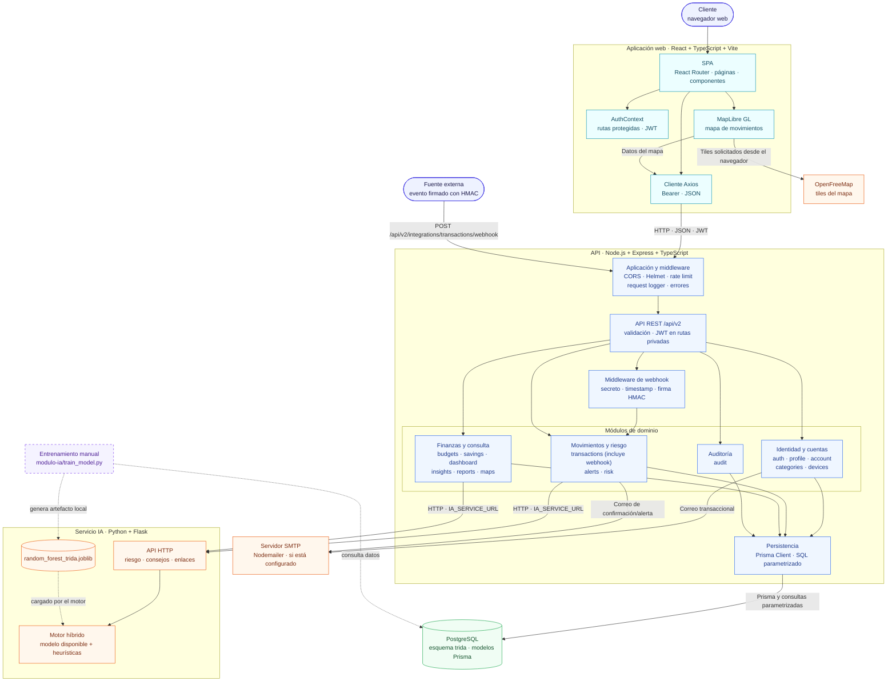

# Arquitectura actual de TriDa

## Alcance del diagrama

Este diagrama representa la arquitectura lógica visible en el código: procesos, módulos, persistencia y dependencias externas. **No es un diagrama de despliegue**; el repositorio no determina si frontend, backend, PostgreSQL, IA o SMTP se ejecutan en máquinas/contenedores separados ni describe balanceadores, redes o servicios cloud.

## Componentes y responsabilidades

| Componente | Tecnología / ubicación | Responsabilidad actual |
| --- | --- | --- |
| Aplicación web | React, TypeScript, Vite; `frontend/src/` | Flujos de usuario, páginas financieras, autenticación de interfaz y mapa. |
| Cliente API | Axios; `frontend/src/api/Client.ts` | Llamadas HTTP a la URL configurada en `VITE_API_BASE_URL`; adjunta JWT Bearer y normaliza errores. |
| API backend | Express/TypeScript; `backend/src/app.ts` | API `/api/v2`, middlewares globales, health checks y documentación Swagger en entornos no productivos. |
| Módulos backend | `backend/src/modules/` | Autenticación, cuentas (`account`), categorías, transacciones (incluye la ruta de webhook), alertas/riesgo, presupuestos, ahorro, dashboard, insights, reportes, mapas, dispositivos y auditoría (`audit`). |
| Persistencia de ejecución | PostgreSQL, Prisma y consultas SQL parametrizadas | Registros financieros y de cuenta en esquema `trida`; restricciones/triggers adicionales están en `database/schema.sql`. |
| Servicio IA | Flask; `modulo-ia/api.py` y `risk_engine.py` | Endpoints de riesgo, consejos/guías y análisis de mensaje/enlace. El backend usa HTTP local/configurable; ciertos flujos tienen respaldo heurístico/local y el escaneo de mensajes reporta fallos. |
| Entrenamiento | `modulo-ia/train_model.py` | Proceso separado que consulta datos de PostgreSQL y produce el archivo del modelo; el backend no lo inicia automáticamente. |
| Correo | Nodemailer y variables SMTP | Envío de verificación, recuperación y confirmación/alertas de movimientos cuando está configurado. |
| Mapa | MapLibre GL en el navegador y estilo OpenFreeMap | La API entrega estadísticas/ubicaciones; el navegador obtiene los tiles del proveedor de mapas. |

## Interfaces y dependencias

- **Navegador → backend:** Axios usa `VITE_API_BASE_URL` (por defecto `http://localhost:3000/api/v2`). El token se adjunta como `Authorization: Bearer`.
- **Fuente externa → backend:** el webhook pasa por `MIDDLE` y el middleware de autenticación HMAC (`WEBHOOK_AUTH`) antes de llegar al controlador y servicio de transacciones.
- **Backend → PostgreSQL:** Prisma Client y consultas SQL parametrizadas; los servicios filtran los registros por usuario autenticado.
- **Backend → IA:** solicitudes HTTP a `IA_SERVICE_URL` (por defecto `http://127.0.0.1:5000`) para riesgo, consejos y análisis de mensajes. Los flujos tienen políticas distintas de timeout y fallback.
- **Backend → SMTP:** dependencia opcional, activada/configurada por variables de entorno.
- **Navegador → OpenFreeMap:** MapLibre obtiene los tiles directamente; no pasan por la API de TriDa.
- **Entrenamiento → PostgreSQL/modelo:** proceso manual separado del flujo online; produce el artefacto que carga el servicio Flask al iniciar.

## Flujos principales

1. **Consulta financiera:** navegador → API REST autenticada → módulos de dominio → Prisma/SQL → PostgreSQL → respuesta JSON.
2. **Evaluación de movimiento:** módulo de transacciones → historial y contexto en PostgreSQL → servicio Flask; si aplica, respaldo local → persistencia de movimiento y alerta.
3. **Movimiento externo:** fuente autorizada → middleware HMAC → controlador/servicio de transacciones → idempotencia y evaluación → PostgreSQL → correo de confirmación cuando corresponde.
4. **Mapa:** página solicita datos geográficos a `/api/v2/map`; MapLibre solicita los tiles al proveedor externo directamente.
5. **Actualización del modelo:** `train_model.py` lee datos y genera el artefacto; el servicio IA lo carga. No se observa un pipeline automático de entrenamiento/despliegue.

## Fuentes de código

- `frontend/src/App.tsx`, `frontend/src/api/Client.ts`, `frontend/src/constants/Api.ts`
- `frontend/src/components/map/InteractiveExpenseMap.tsx`
- `backend/src/app.ts`, `backend/src/index.ts`, `backend/src/config.ts`
- `backend/src/modules/`, `backend/src/db/prisma.ts`
- `backend/src/modules/alerts/risk.service.ts`, `backend/src/modules/insights/`
- `backend/src/utils/mailer.ts`
- `backend/prisma/schema.prisma`, `database/schema.sql`
- `modulo-ia/api.py`, `modulo-ia/risk_engine.py`, `modulo-ia/train_model.py`
