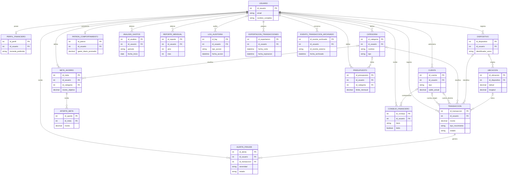

# MER TriDa

## Modelo entidad-relación conceptual

El MER expresa conceptos y cardinalidades; no sustituye las restricciones físicas de PostgreSQL. Las categorías globales pueden no tener usuario propietario; las categorías personalizadas sí. Una transacción puede no estar asociada a cuenta, categoría, dispositivo o ubicación.

## Consideraciones

- Se muestran claves y atributos representativos para hacer visible el contenido de las entidades; el detalle completo de columnas y tipos está en el [MR TriDa](./MR-TriDa.md).
- `EVENTO_TRANSACCION_ARCHIVADO` también almacena `id_cuenta` y datos del evento original; Prisma no declara una relación ORM con `CUENTA` para esa columna.
- `EXPORTACION_TRANSACCIONES.ids_transacciones` es una lista de identificadores, no una relación FK a cada transacción.
- Las entidades reflejan los modelos actuales de `backend/prisma/schema.prisma` y el esquema canónico `database/schema.sql`.
- `PATRON_COMPORTAMIENTO` es una entidad activa a nivel de base de datos: un trigger crea o actualiza su marca temporal y existe una función SQL para leerla. Sin embargo, el endpoint de HU-11 calcula las métricas directamente desde transacciones y no consulta esa entidad. `ANALISIS_GASTOS` y `REPORTE_MENSUAL` tienen funciones SQL de lectura y datos de ejemplo en el seed, pero las rutas actuales de HU-28 y HU-29 calculan respuestas bajo demanda y no leen ni escriben esos modelos. Se documentan como persistencia/consultas SQL sin integración en esos flujos de producto.
