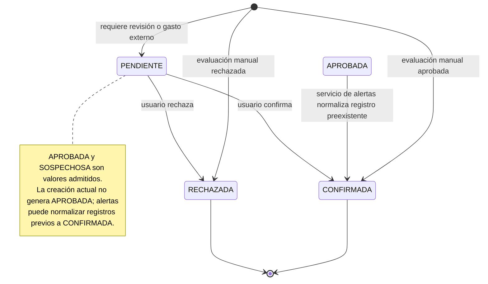
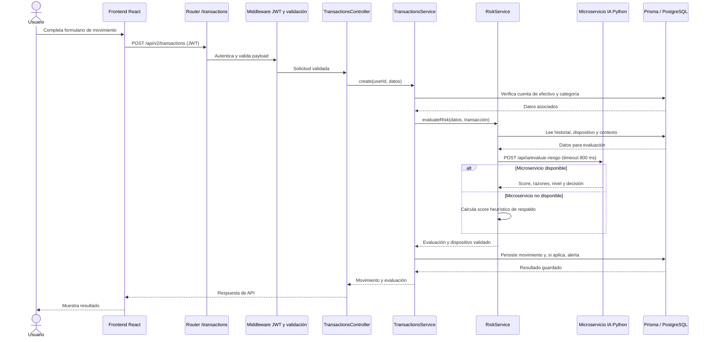

# UML TriDa

## Diagrama de clases (entidades del dominio y soporte)

Se muestran las 18 entidades del modelo, sus atributos representativos y las relaciones respaldadas por claves foráneas. Las operaciones de aplicación pertenecen a controladores/servicios y no se presentan como métodos de las entidades. El esquema relacional completo se documenta en [MR TriDa](./MR-TriDa.md).

```mermaid
classDiagram
  class Usuario {
    +Int id_usuario
    +String email
    +String rol
    +Boolean estado
  }
  class PerfilFinanciero {
    +Int id_perfil
    +Decimal ingreso_mensual
    +String moneda_preferida
    +String tolerancia_riesgo
  }
  class Cuenta {
    +Int id_cuenta
    +String tipo
    +Decimal saldo_actual
    +Boolean estado
  }
  class Categoria {
    +Int id_categoria
    +String tipo
    +Boolean es_default
  }
  class Transaccion {
    +Int id_transaccion
    +String tipo_movimiento
    +Decimal monto
    +String estado
    +DateTime fecha_transaccion
  }
  class Dispositivo {
    +Int id_dispositivo
    +Boolean confiable
  }
  class Ubicacion {
    +Int id_ubicacion
    +Decimal latitud
    +Decimal longitud
  }
  class AlertaFraude {
    +Int id_alerta
    +String severidad
    +String estado
  }
  class Presupuesto {
    +Int id_presupuesto
    +Decimal limite_mensual
    +Int mes
    +Int anio
  }
  class MetaAhorro {
    +Int id_meta
    +Decimal monto_objetivo
    +Decimal monto_actual
  }
  class AporteMeta {
    +Int id_aporte
    +Decimal monto
    +DateTime fecha_aporte
  }
  class PatronComportamiento {
    +Int id_patron
    +Json categorias_top
    +DateTime fecha_actualizacion
  }
  class ConsejoFinanciero {
    +Int id_consejo
    +String titulo
    +Boolean leido
    +DateTime fecha_generado
  }
  class ExportacionTransacciones {
    +Int id_exportacion
    +DateTime fecha_corte
    +DateTime fecha_expiracion
    +DateTime fecha_descarga
  }
  class EventoTransaccionArchivado {
    +Int id_evento_archivado
    +String fuente_externa
    +String id_evento_externo
    +DateTime fecha_archivado
  }
  class AnalisisGastos {
    +Int id_analisis
    +String periodo
    +Date fecha_inicio
    +Date fecha_fin
  }
  class ReporteMensual {
    +Int id_reporte
    +Int anio
    +Int mes
    +Decimal score_salud
  }
  class LogAuditoria {
    +Int id_log
    +String tipo_accion
    +DateTime fecha_accion
  }
  Usuario "1" --> "0..*" Cuenta : administra
  Usuario "1" --> "0..1" PerfilFinanciero : posee
  Usuario "0..1" --> "0..*" Categoria : define
  Usuario "1" --> "0..*" Transaccion : registra
  Cuenta "0..1" --> "0..*" Transaccion : origen
  Cuenta "0..1" --> "0..*" Transaccion : destino
  Categoria "0..1" --> "0..*" Transaccion : clasifica
  Dispositivo "0..1" --> "0..*" Transaccion : identifica
  Ubicacion "0..1" --> "0..*" Transaccion : ubica
  Usuario "1" --> "0..*" Dispositivo : registra
  Usuario "1" --> "0..*" Presupuesto : define
  Usuario "1" --> "0..*" MetaAhorro : define
  Usuario "1" --> "0..1" PatronComportamiento : caracteriza
  Usuario "1" --> "0..*" ConsejoFinanciero : recibe
  Usuario "1" --> "0..*" AlertaFraude : recibe
  Usuario "1" --> "0..*" ExportacionTransacciones : prepara
  Usuario "1" --> "0..*" EventoTransaccionArchivado : conserva
  Usuario "1" --> "0..*" AnalisisGastos : obtiene
  Usuario "1" --> "0..*" ReporteMensual : obtiene
  Usuario "0..1" --> "0..*" LogAuditoria : audita
  Cuenta "0..1" --> "0..*" ConsejoFinanciero : contextualiza
  Categoria "0..1" --> "0..*" Presupuesto : limita
  Categoria "0..1" --> "0..*" MetaAhorro : clasifica
  MetaAhorro "1" *-- "0..*" AporteMeta : contiene
  Transaccion "1" --> "0..*" AlertaFraude : genera
```



`EventoTransaccionArchivado.id_transaccion_original` y `ExportacionTransacciones.ids_transacciones` son referencias conservadas como datos, no relaciones FK declaradas en Prisma.

## Estados de transacción



Los gastos recibidos por webhook permanecen `PENDIENTE` hasta la respuesta del enlace de correo. La decisión repetida de una transacción resuelta se rechaza; la repetición idéntica en la resolución de una alerta sí devuelve el resultado existente. `APROBADA` y `SOSPECHOSA` son valores admitidos por la base y algunas consultas, pero no se observó un flujo actual que los asigne.

## Secuencia: registro manual de una transacción



## Secuencia: webhook y confirmación de gasto externo

```mermaid
sequenceDiagram
  actor E as Emisor externo
  participant R as Router de integraciones
  participant M as Middleware HMAC
  participant C as TransactionsController
  participant S as TransactionsService
  participant Risk as RiskService
  participant IA as Microservicio IA Python
  participant DB as Prisma / PostgreSQL
  participant SMTP as Servicio SMTP
  actor U as Usuario
  participant UI as Frontend

  E->>R: POST /api/v2/integrations/transactions/webhook
  R->>M: Valida secreto, timestamp y firma HMAC del cuerpo
  alt Firma o timestamp inválido
    M-->>E: Rechaza evento antes del servicio
  else Evento autenticado
    M->>C: Entrega evento validado
    C->>S: ingestExternalTransaction(evento)
    alt Es gasto y SMTP no está configurado
      S-->>E: Rechaza antes de crear movimiento
    else SMTP disponible o no es gasto
      S->>DB: Comprueba cuenta activa e idempotencia
      alt Evento duplicado e idéntico
        DB-->>S: Devuelve movimiento existente
      else Evento nuevo
        S->>Risk: Evalúa riesgo
        Risk->>DB: Lee historial, dispositivo y contexto
        DB-->>Risk: Datos para evaluación
        Risk->>IA: POST /api/ia/evaluar-riesgo
        alt Microservicio disponible
          IA-->>Risk: Score y clasificación
        else Microservicio no disponible
          Risk->>Risk: Calcula score heurístico de respaldo
        end
        Risk-->>S: Evaluación
        S->>DB: Persiste movimiento y alerta si aplica
        DB-->>S: Movimiento guardado
      end
      opt Gasto pendiente sin correo de confirmación enviado
        S->>SMTP: Envía enlace firmado
        alt Envío exitoso
          SMTP-->>U: Correo de confirmación
          S->>DB: Registra fecha de envío
        else Error de envío
          S-->>E: Informa el fallo; movimiento queda pendiente
        end
      end
      S-->>C: Resultado de ingreso
      C-->>E: Respuesta de API
    end
  end
  opt Usuario abre el enlace recibido
    U->>UI: Abre enlace firmado
    UI->>R: GET detalle de confirmación
    R->>C: Consulta token
    C->>S: getEmailConfirmation(token)
    S->>DB: Consulta movimiento pendiente
    DB-->>S: Detalle del movimiento
    S-->>UI: Detalle para confirmar
    U->>UI: Indica si reconoce el gasto
    UI->>R: POST decisión de confirmación
    R->>C: Procesa decisión
    C->>S: resolveEmailConfirmation(token, decisión)
    S->>DB: Actualiza estado, saldo/alerta y auditoría
    DB-->>S: Resultado guardado
    opt Usuario no reconoce el gasto
      S->>SMTP: Envía notificación de alerta crítica
      alt Envío de alerta falla
        S-->>UI: Rechazo y alerta persisten; informa fallo de notificación
      end
    end
    S-->>UI: Confirmación procesada
    UI-->>U: Muestra resultado
  end
end
```

El envío del correo inicial ocurre después de persistir el gasto; si ese envío falla, el movimiento permanece pendiente. El chequeo previo de configuración SMTP evita crear gastos cuando el correo no está configurado. El proceso Python es independiente y no lo inicia automáticamente el backend.
